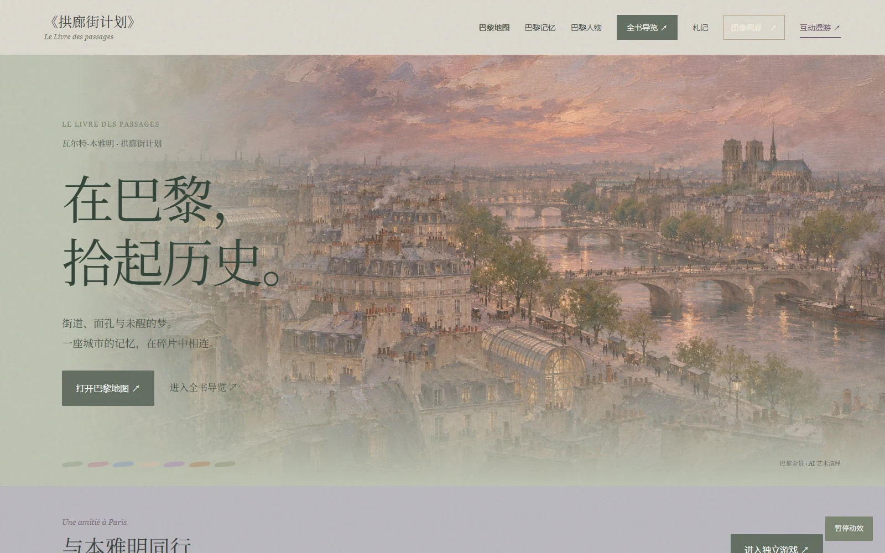
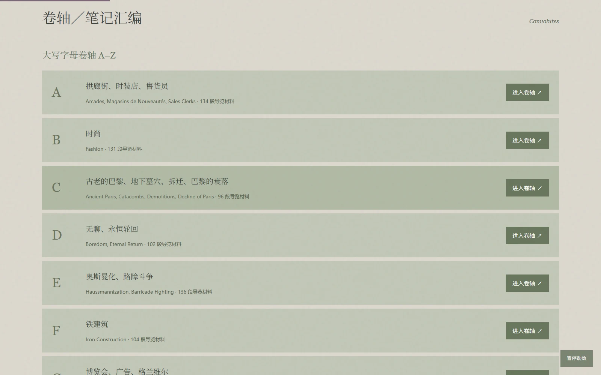
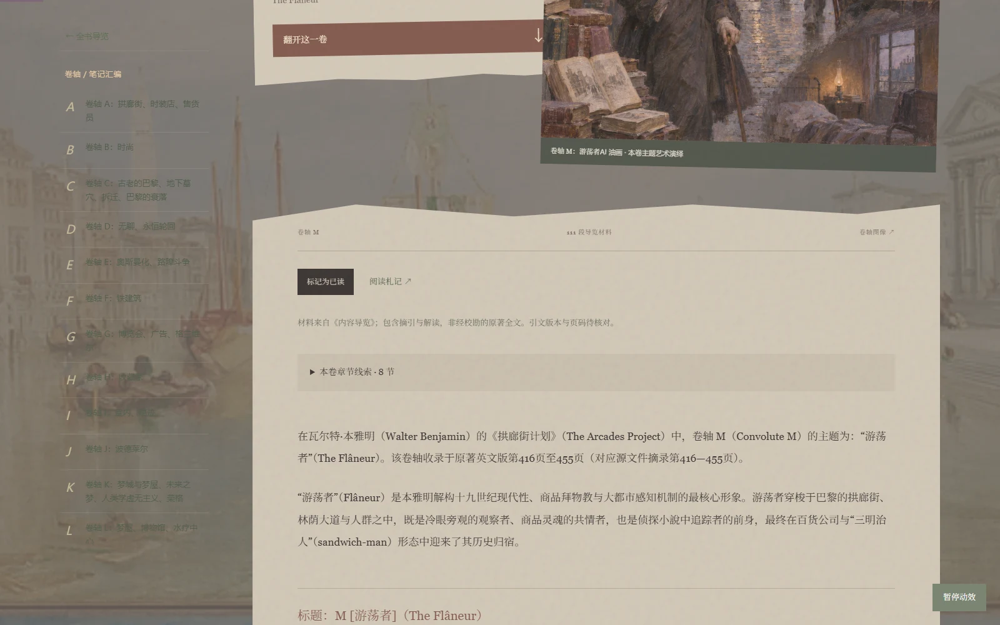
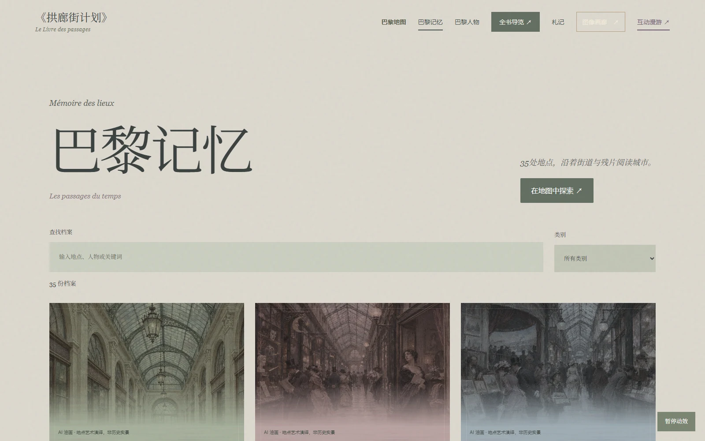
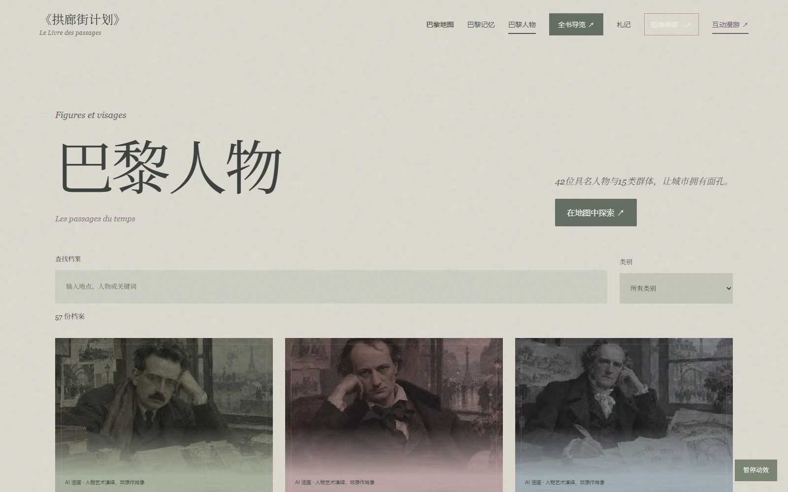
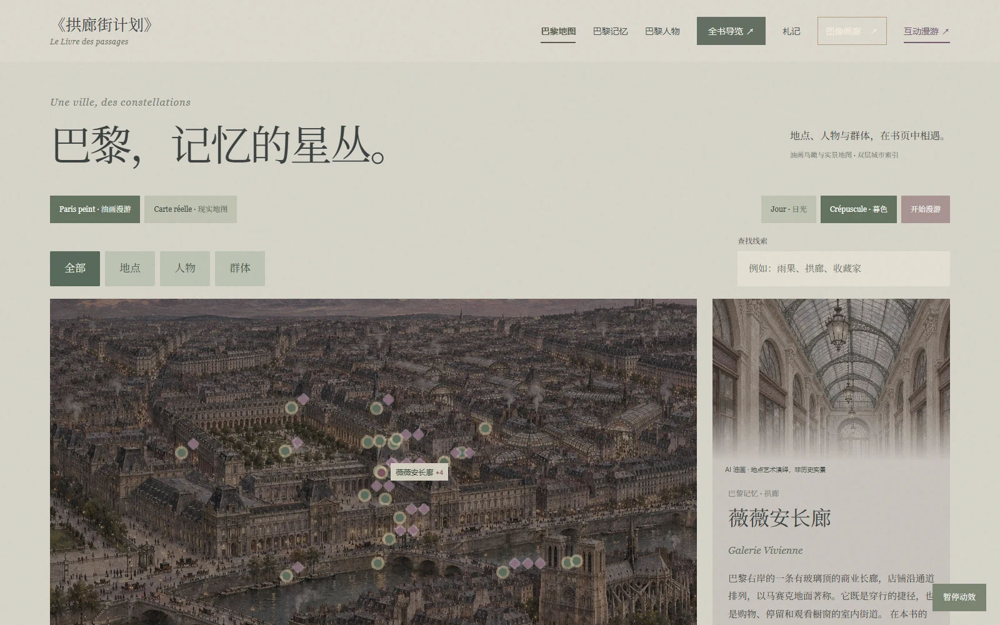
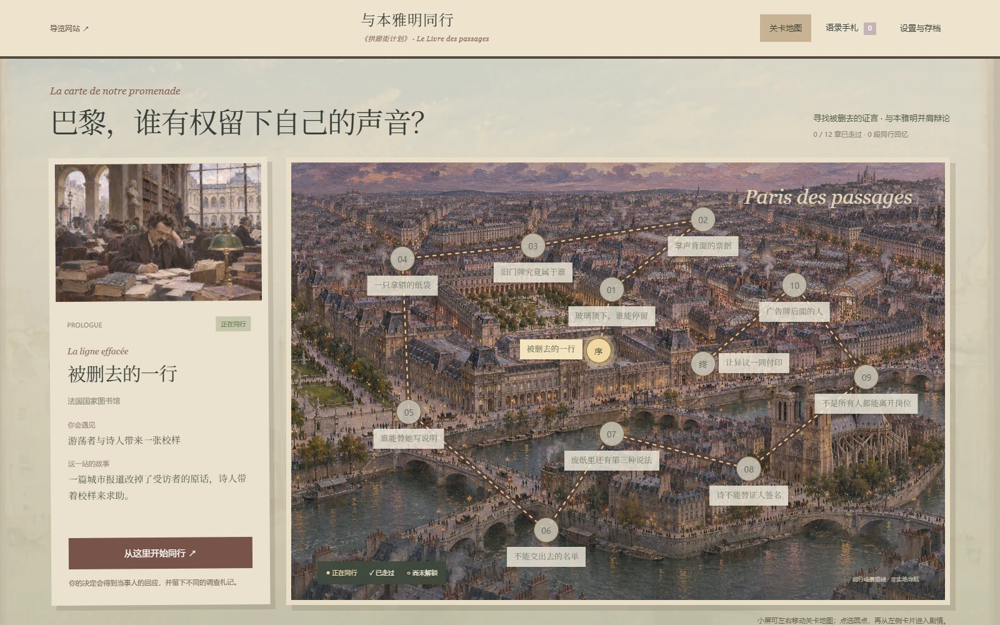
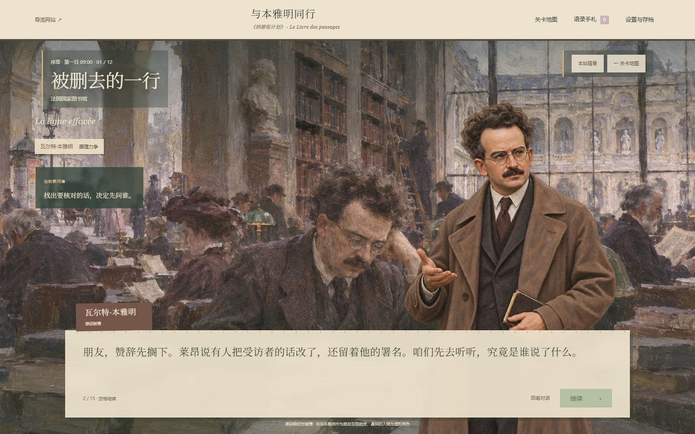
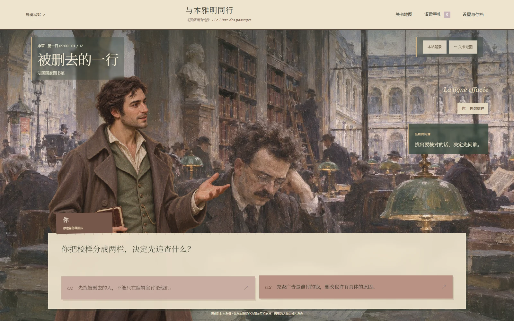
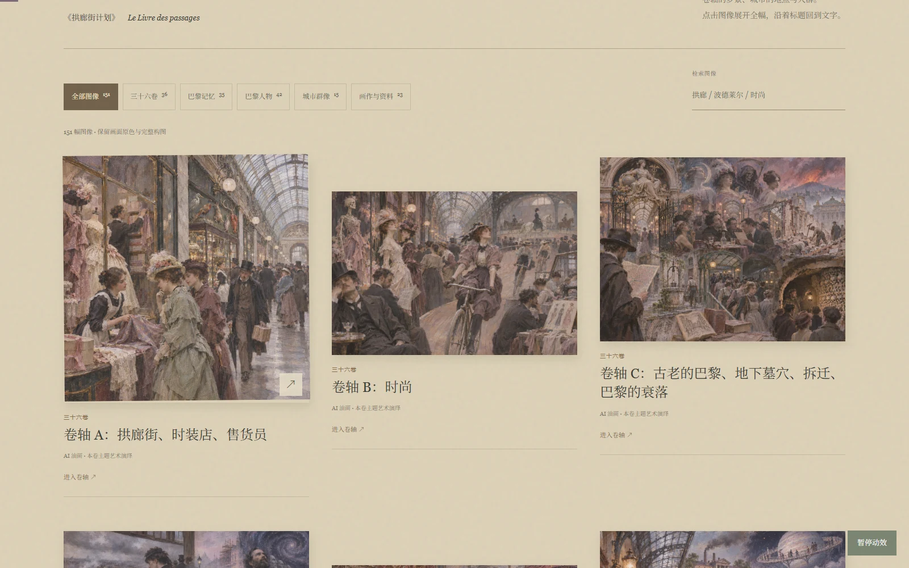

<div align="center">

# 《拱廊街计划》

### Le Livre des passages · 与本雅明同行

**一座可以阅读的巴黎，一场与朋友并肩而行的漫游。**

[打开阅读网站](https://arcades-paris-reading-atlas.moderncrumb2.chatgpt.site/) · [进入独立游戏](https://arcades-paris-reading-atlas.moderncrumb2.chatgpt.site/game.html) · [浏览图像画廊](https://arcades-paris-reading-atlas.moderncrumb2.chatgpt.site/#gallery)

</div>



> 本页配图均为项目实际页面的电脑端截图，视口为 **1600 × 1000**，点击图片可以查看大图。

## 这是什么项目？

瓦尔特·本雅明的《拱廊街计划》由大量摘录、笔记与思想片段组成。拱廊、时尚、广告、摄影、游荡者和街头劳动者彼此交错，阅读的困难往往在于：我们还不知道一个地名在哪里，也不知道一句话中的人是谁。

这个项目尝试给阅读增加几条入口：先看一张图，认识一个人，走进一个地点，再沿着线索回到卷轴。它由两个相互连接的部分组成：

| 入口 | 可以做什么 | 直接访问 |
| --- | --- | --- |
| **可视化阅读导览** | 翻阅全书目录与主题卷轴，在地图、地点、人物和图像之间检索线索，记录阅读札记 | [阅读网站](https://arcades-paris-reading-atlas.moderncrumb2.chatgpt.site/) |
| **独立剧情游戏** | 以本雅明朋友的身份走过巴黎，听见不同人的处境，通过对话与选择推进十二站路线 | [与本雅明同行](https://arcades-paris-reading-atlas.moderncrumb2.chatgpt.site/game.html) |

网站公开访问，**不需要 ChatGPT 账号**。导览与游戏保留各自的入口，读者可以自由选择先读书还是先游玩。

## 已经可以体验什么？

### 01 · 全书导览：给碎片一个可以进入的结构

目录按英文版框架建立七个部分：**译者前言、提纲／大纲、卷轴／笔记汇编、第一批草稿、早期草稿、补遗／预备材料、学术评论与参考附录**。

现有 **51 个目录入口、36 个主题卷轴、2207 段导览材料**。卷轴保留大写 A–Z 与小写 a、b、d、g、i、k、l、m、p、r 的编号体系；缺少独立材料的篇目明确显示“材料待补”。支持按人物、地点、关键词和笔记编号检索。



### 02 · 卷轴阅读：图像、摘录与阅读札记

每个卷轴拥有对应主题图像，正文通过纸张、油画和拼贴组织材料。较长篇目随文插图，并保留章节线索、引文编号、前后篇目和阅读标记；读者可以把自己的问题留在札记中。



### 03 · 巴黎记忆：先了解一个地方，再追踪它的意义

已建立 **35 处地点**的档案，包括拱廊、车站、旧市场、河岸与城市公共空间。每个地点结合身份简介、主题图像和卷轴线索，让陌生的名字变成可以辨认的城市位置。



### 04 · 巴黎人物：从名字走向真实的身份与处境

收录 **42 位具名人物、15 类群体**。除了诗人、思想家和城市改造者，也为游荡者、店员、拾荒者、赌徒、性工作者与三明治人等群体建立入口。介绍先说明“他们是谁”，再连接书中的材料。



例如，“三明治人”指在身体前后悬挂广告牌、沿街替商家宣传的劳动者。档案把这一身份与广告、身体和城市劳动的阅读线索放在一起。


### 05 · 巴黎地图：从油画中的位置，连接现实中的城市

油画地图把地点、人物与阅读线索集中在同一个入口。点击地点可以展开档案、查看关联材料；具备坐标的地点还可以跳转至 **Google Maps、街景或 OpenStreetMap**。

地图中的历史线索与今天的地理位置分开说明。人物与地点的关联依据导览材料组织，不能据此认定每位人物曾在该处活动；当代街景也不等同于十九世纪的历史原貌。



## 独立游戏 · 与本雅明同行

### 一段友谊，一条十二站的路线

玩家是一位约三十至三十五岁的男性，与本雅明是能够相互理解、也能够争辩的朋友。游戏围绕一份被改写的城市报道展开：你们寻找原话、辨认被删去的声音，在不同地点听取当事人的讲述，再决定如何回应。

**关卡地图 → 本站背景与任务 → 人物对话 → 选择与回应 → 手札与下一站**，构成基本游玩循环。游戏通过明确的地图和每站目标连接情节，避免把哲学观点直接变成脱离情境的问答题。



### 与人交谈，再一起想明白

你会遇到店员、赌徒、广告劳动者及其他城市群体。人物的利益、误解和争执推动剧情，本雅明的观点结合眼前事件以语录或手札形式出现。

对话采用角色立绘：**谁开口，谁出场**；玩家与其他交谈者在左侧，本雅明在右侧，并随情节呈现不同神态。选择会引出人物回应，章节进度与收集记录保存在当前浏览器。





游戏是一场跨时空的文学漫游。事件、玩家和 NPC 为创作设定；观点改写与原文摘引分别标示，不能把游戏台词当成本雅明的逐字引文。

## 视觉与图像

网站以莫兰迪色系、油画笔触、法文题签和纸张拼贴营造巴黎的阅读氛围，并让日光与暮色随页面语境变化。图像画廊提供按类别浏览、搜索和完整画幅查看的入口。



图像包括历史肖像、公共领域艺术作品，以及为卷轴、地点和虚构角色制作的 AI 艺术演绎。具体来源和性质在网站的“版本与资料说明”与图像画廊中保留。透纳的威尼斯画作用作色彩与氛围背景，页面明确说明其画中地点，不将它作为巴黎历史图像。

## 推荐的开始方式

1. **想读书**：打开“全书导览”，选一个熟悉的主题，例如时尚、摄影或游荡者，再查看本卷材料。
2. **想认识巴黎**：打开“巴黎记忆”或“巴黎地图”，从地点档案进入相关卷轴。
3. **对人物感兴趣**：先读“巴黎人物”的身份简介，再追踪其在导览中的线索。
4. **想先体验故事**：进入独立游戏，从关卡地图开始，按本站任务推进对话。
5. **想留住想法**：使用阅读标记与札记。记录保存在当前浏览器，换设备前请先导出札记。

## 本地运行

项目使用 **原生 HTML、CSS 与 JavaScript**，无需安装前端框架、构建工具或 API 密钥。

```sh
git clone https://github.com/zhihanxie78-cloud/arcades-paris.git
cd arcades-paris
python -m http.server 8080 --directory dist
```

打开阅读网站：<http://localhost:8080/>  
打开游戏：<http://localhost:8080/game.html>

也可以直接打开 `dist/index.html` 或 `dist/game.html`。推荐通过本地 HTTP 服务预览；外部地图、街景与资料链接需要联网。GitHub 仓库提供源码，线上体验请使用本页顶部的网站链接。

## 项目结构

```text
dist/
  index.html           阅读导览入口
  game.html            独立游戏入口
  data.js              全书目录与导览材料
  book.js              全书目录、检索与卷轴阅读
  atlas-data.js        地点、人物、群体及关联线索
  atlas-intros.js      身份简介与外部参考资料
  atlas.js             档案与专题入口
  immersion.js         地图、地理链接与视觉组织
  collage.js           拼贴阅读与图像画廊
  novel-data.js        游戏章节、对白与背景
  novel-core.js        游戏状态与分支
  novel.js             游戏界面与交互
  assets/              本地图像、角色立绘与背景
docs/
  screenshots/         本页使用的实际电脑端截图
  全书结构说明.md       目录组织与材料状态
  游戏出场与场景版说明.md
  对白与身份简介更新说明.md
```

## 材料状态与后续补充

本项目仍在持续阅读与整理中。当前目录已搭建，已有材料可以浏览；**导览不等于经校勘的原著全文**，所收录材料包含摘引、译文与解读，仍需逐条核对正式版本、页码和归属。

接下来希望继续完善：

- 补齐尚缺的独立篇目材料，保留清楚的材料状态。
- 为摘引增加更完整的版本、页码和来源说明。
- 深化人物、地点与卷轴之间的关联，并校对历史信息。
- 根据阅读和游玩反馈，继续调整剧情节奏、交互和移动端体验。

欢迎通过 [Issues](https://github.com/zhihanxie78-cloud/arcades-paris/issues) 提交文字勘误、资料线索、图片来源补充及体验问题。反馈时附上页面链接、卷轴编号或游戏站点，会更方便定位。

## 设计参考与致谢

- [Taste-skill](https://github.com/Leonxlnx/taste-skill)：设计与页面编排参考。
- Wikimedia Commons、纽约大都会艺术博物馆等公开馆藏：历史肖像与公共领域画作，具体条目见站内资料说明。
- [awesome-claude-video-skills](https://github.com/zhuyansen/awesome-claude-video-skills)：视频制作技能导航。
- [code-video-showcase](https://github.com/Moessif/code-video-showcase)：项目介绍视频采用的代码渲染制作流程。

源码在本仓库公开供查看与交流。书籍摘引、历史图像、外部资料与其他素材各有其来源及适用条件，仓库目前未为全部内容统一指定许可；使用具体素材前，请查看对应说明。
